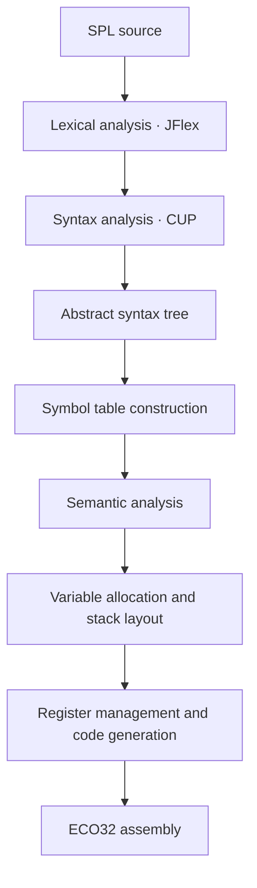

# SPL Compiler — Java / ECO32

A multi-phase compiler for the SPL educational programming language, developed as part of the Compilerbau module at Technische Hochschule Mittelhessen (THM). The compiler translates SPL source programs into ECO32 assembly and exposes intermediate phases through a command-line interface.

## Compiler architecture



## Implementation overview

| Phase | Implementation |
| --- | --- |
| Lexical analysis | JFlex scanner specification |
| Syntax analysis and AST | CUP grammar and Java AST classes |
| Symbol tables | Global and local declarations, predefined procedures and types |
| Semantic analysis | Procedure bodies, types, expressions and statements |
| Variable allocation | Stack layout and variable/parameter storage |
| Code generation | ECO32 instructions, register management and procedure frames |

The source includes implementations for every phase above. This is a coursework implementation, not a claim of complete language conformance or production readiness.

## Technology stack

Java 21 · Maven · JFlex 1.7.0 · Java CUP · ECO32 assembly

## Build and run

Requirements: JDK 21 and Apache Maven (with access to Maven Central). On macOS, Maven can be installed with `brew install maven`; install JDK 21 separately if necessary.

```bash
java -version
mvn -version
mvn clean package
java -jar target/spl-0.1.jar --help
```

Compile a simple SPL program to assembly:

```bash
java -jar target/spl-0.1.jar examples/smoke/hello.spl target/hello.s
```

```text
proc main() {
    var x: int;
    x := 40 + 2;
    printi(x);
}
```

The compiler produces assembly, not a native executable. Assembling, linking and executing it requires a separate compatible ECO32 toolchain and runtime libraries, which are not bundled here.

### Inspect individual phases

```bash
java -jar target/spl-0.1.jar --tokens examples/smoke/hello.spl
java -jar target/spl-0.1.jar --absyn examples/smoke/hello.spl
java -jar target/spl-0.1.jar --tables examples/smoke/hello.spl
java -jar target/spl-0.1.jar --semant examples/smoke/hello.spl
java -jar target/spl-0.1.jar --vars examples/smoke/hello.spl
```

`--parse` is also available for syntax checking. With no phase flag the full pipeline runs.

## Repository structure

```text
spl-compiler/
├── pom.xml
├── src/main/java/de/thm/mni/compilerbau/
│   ├── Main.java
│   ├── CommandLineOptions.java
│   ├── absyn/           # AST nodes and visitors
│   ├── phases/          # Compiler passes
│   ├── table/           # Symbol table and entries
│   ├── types/           # Type representation
│   └── utils/           # Diagnostics and helpers
├── examples/
│   ├── smoke/           # Minimal positive and negative inputs
│   └── course-samples/  # Archived SPL inputs (mixed validity)
├── scripts/
│   └── smoke-test.sh
└── docs/
    └── provenance.md
```

## Verification

Run the smoke checks after installing Maven and Java 21:

```bash
bash scripts/smoke-test.sh
```

The script builds the JAR, exercises each exposed intermediate phase, checks assembly output and checks rejection of invalid syntax and an undeclared variable. The archived course samples include valid and invalid inputs; they are not a curated automated regression suite.

**Verification status:** Source reviewed during repository preparation; clean Maven build and smoke checks have not yet been executed. ECO32 execution has not been verified.

## Academic context and attribution

Coursework by Mohamed Amine GuezGuez, B.Sc. Informatik, THM. This project builds on the course-provided SPL compiler skeleton. Original scaffolding, examples and third-party dependencies remain attributable to their respective authors. See [provenance and publication notes](docs/provenance.md). No open-source license is asserted for course-provided material. Confirm redistribution permission before making this repository public.
